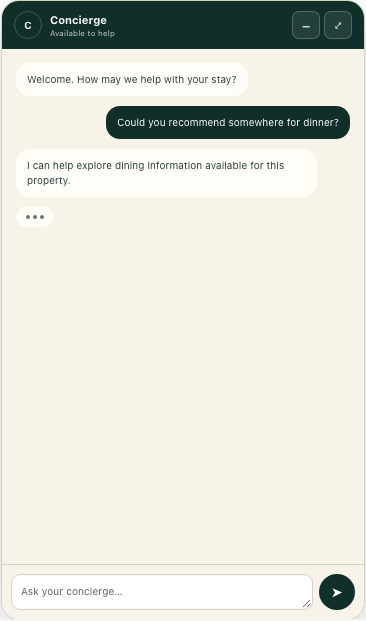
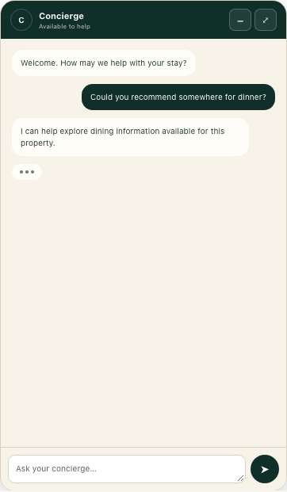
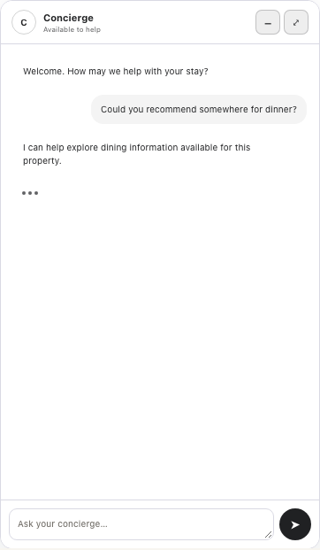
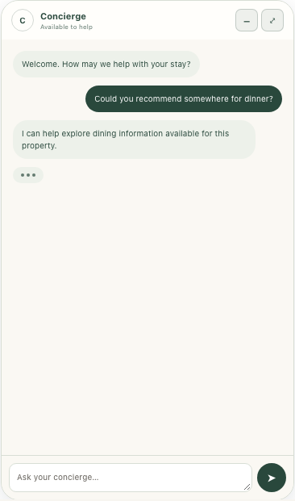
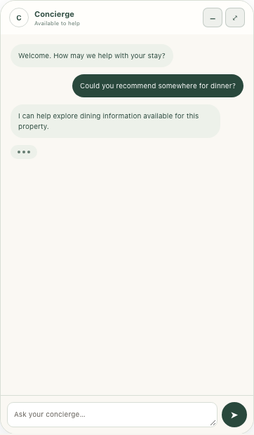
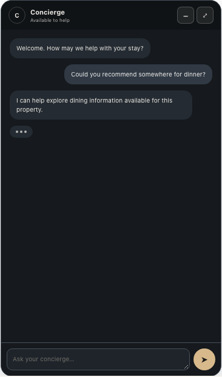
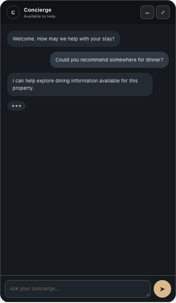
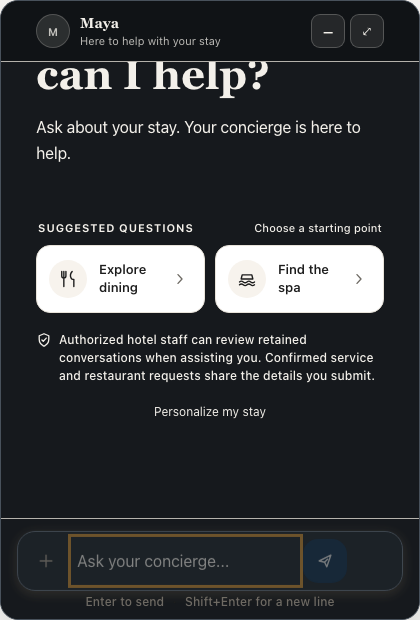
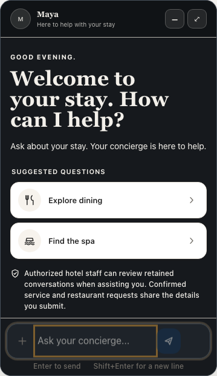

# AI Chat Designer visual review

These captures were generated by the `AI Chat Designer switches presets` Playwright regression. Preset captures show the live admin preview after selecting each style in desktop and mobile preview modes. Published captures show the actual guest floating chat after the draft was published: desktop at a 1404px browser width and mobile at 375 × 812px.

The review confirmed four distinct styles: warm ivory and emerald for Luxury, white and charcoal for ChatGPT Inspired, soft sage surfaces for Boutique, and charcoal with champagne controls for Midnight. The published Midnight review caught low-contrast welcome copy and a landing-theme override on the chat input; both were corrected and covered by contrast and token assertions in the regression.

## Luxury Chat

| Desktop preview | Mobile preview |
| --- | --- |
|  |  |

## ChatGPT Inspired

| Desktop preview | Mobile preview |
| --- | --- |
|  |  |

## Boutique Chat

| Desktop preview | Mobile preview |
| --- | --- |
|  |  |

## Midnight Chat

| Desktop preview | Mobile preview |
| --- | --- |
|  |  |

## Published guest floating chat

| Desktop | Mobile |
| --- | --- |
|  |  |
