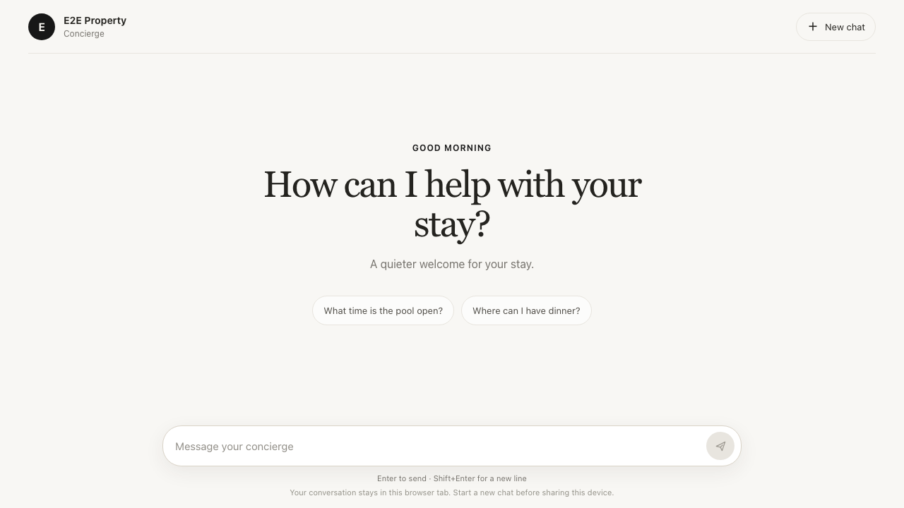
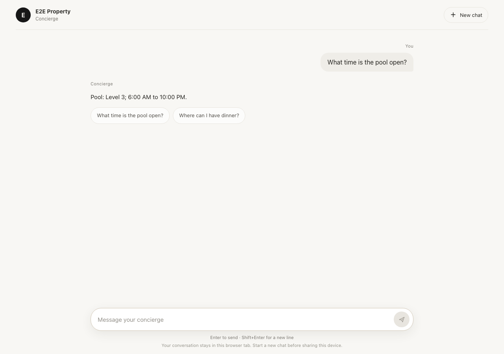
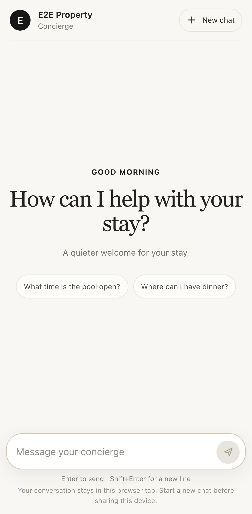
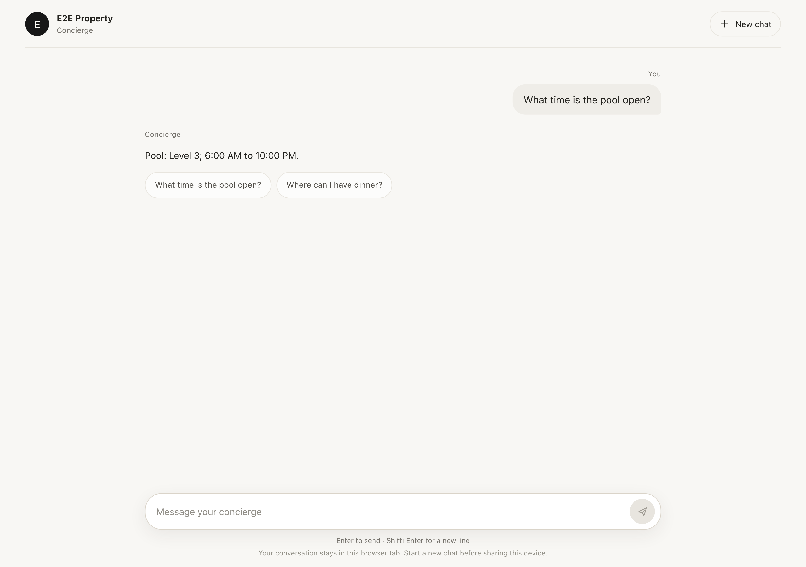

# Intelligent guest UI design system

## Direction

The v2 page is a quiet, conversation-first concierge workspace. It replaces the home dashboard with hotel identity, a contextual greeting, a short invitation, optional starter prompts, and one multiline composer. After the first message, the welcome section gives way to a readable transcript. The transcript remains visible while requests run.

The visual system uses warm neutral surfaces, restrained property accents, a desktop maximum width, clear text hierarchy, modest rounded controls, and reduced-motion support. It avoids a hero image, service grid, carousel, and permanent dashboard.

## Tokens and rules

| Token | Default | Use |
| --- | --- | --- |
| `--page` | `#f8f7f4` | Main background |
| `--surface` | `#ffffff` | Composer, cards, panels |
| `--ink` | `#24231f` | Primary text |
| `--muted` | `#76736d` | Supporting text |
| `--line` | `#e8e5de` | Dividers and outlines |
| `--accent` | `#9a7744` | Send/confirm actions and small emphasis; uses valid property primary color when configured |
| `--user-surface` | `#efede8` | Guest message surface |
| `--focus` | `#315f9b` | Keyboard focus |

The UI allows only same-origin property logo images. AI text and all property-provided text are assigned with `textContent`; response blocks cannot provide markup, CSS, scripts, image URLs, or arbitrary links.

## Responsive behavior

The browser suite checks 320, 375, 390, 430, 768, 1024, 1440, and 1920 pixel widths. The composer respects safe-area insets on mobile, message text wraps naturally, and cards collapse to one column on narrow screens. Reduced-motion preferences disable the typing animation.

## Real browser screenshots

Screenshots were captured from the local Playwright run, not generated mockups.

