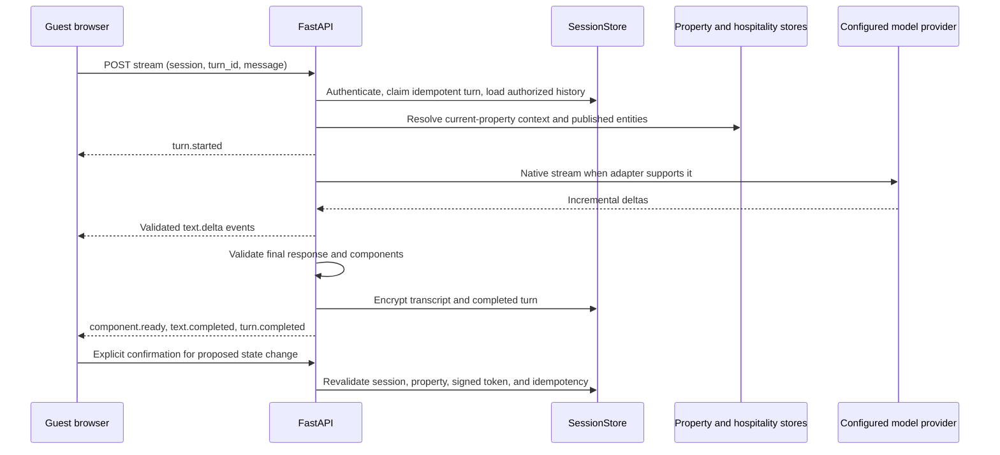

# Intelligent UI Phase 2 architecture

## Scope and decision

The Intelligent UI remains an opt-in presentation layer over the existing guest session, property resolver, chat policy, and service-action APIs. It is selected only when the environment master switch, persisted global operational switch, and current property's strict boolean opt-in are all enabled. Otherwise `/` and the V2-only assets/APIs use the legacy experience or fail closed.

The browser submits a stable `turn_id` to `POST /api/guest/intelligent-chat/stream`. The server authenticates the guest session and resolves its property before it loads history, reads property content, routes a provider, creates cards, or returns a map. AI text and data components use the versioned `1.0` schema. Service requests use the existing signed proposal and explicit confirmation endpoint; a stream event cannot execute an action.

Provider-native SSE adapters are implemented for OpenAI-compatible providers, Gemini, Claude, and the local adapter. Providers reporting no streaming capability use the existing one-shot send path and are explicitly marked non-streaming. Fallback is permitted before the first provider delta; after a delta, the turn fails instead of appending a second provider's answer.

The map component uses the existing `ZoneStore` floor-map files and guest-visible navigation nodes for the authenticated property. It loads same-origin uploaded raster/SVG plans lazily and positions accessible buttons using bounded percentages derived from stored map dimensions. It does not fetch third-party tiles. When a verified map or markers are absent, the response asks the guest to contact the Front Desk instead of generating directions.

## Compatibility and boundaries

- Legacy guest UI and `/api/chat` remain available under the existing feature switch.
- Admin routes and permissions are unchanged except for the audited global Intelligent UI switch.
- Existing service request creation remains in the backend proposal/confirmation path.
- The current guest map is a location view; the application does not infer a route from a room number. It says so explicitly.
- New tables are additive. Existing transcript rows remain readable; new transcript and Intelligent UI turn content is encrypted.

See [streaming protocol](STREAMING_PROTOCOL.md), [component registry](COMPONENT_REGISTRY.md), [conversation persistence](CONVERSATION_PERSISTENCE.md), and [rollback](FEATURE_FLAG_ROLLBACK.md) for operating details.
